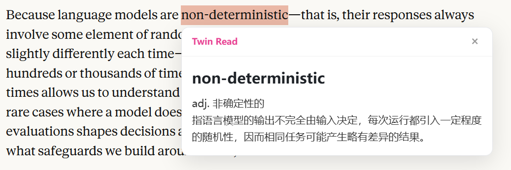
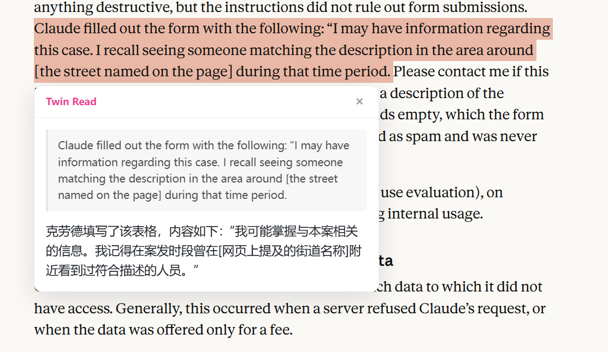
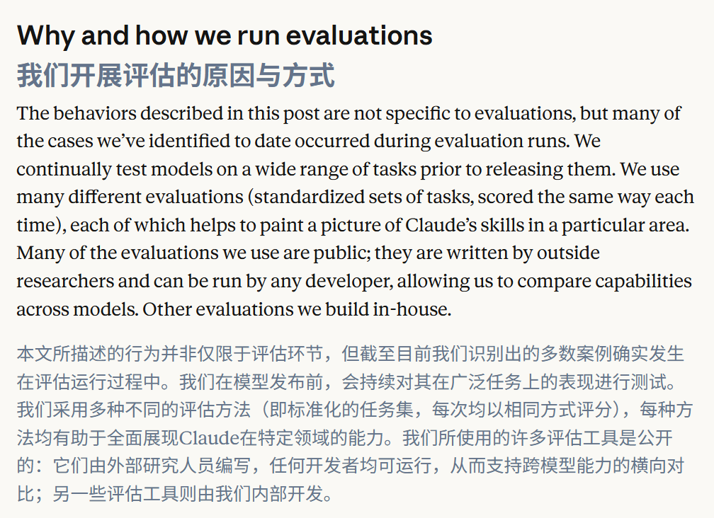

<div align="center">

# Twin Read

**轻量级沉浸式双语翻译 Chrome 扩展 · 大模型驱动**

[](LICENSE)
[](https://developer.chrome.com/docs/extensions/develop/migrate)
[](tsconfig.json)
[](#%EF%B8%8F-%E5%BC%80%E5%8F%91)

*A lightweight immersive bilingual reading extension for Chrome, powered by any OpenAI-compatible LLM (default: Qwen).*

</div>

---

Twin Read 让你用一套自己的 API Key，在任意网页获得「原文 + 译文」对照阅读体验：整页翻译保持原文排版与格式对齐，划词取义基于上下文给出语境化释义——不发请求到第三方中转服务，**你的 Key 只属于你**（[隐私政策](PRIVACY.md)：不收集任何用户数据，无埋点、无上传）。

## ✨ 特性

### 🌐 整页对照式翻译

- **格式对齐**：译文在原文下方独立成行，字体、字号、行高、对齐与排版宽度均与原文一致
- **视口懒翻译**：基于 IntersectionObserver，只翻译正在阅读的段落（底部 600px 预加载），长页面不浪费 token
- **批量请求**：按「块数 ≤ 20 / 字符 ≤ 2000」双预算分批，后台最多 3 并发
- **同页缓存**：关闭再开启即时恢复译文，零重复请求
- **不破坏页面**：`insertBefore` 兄弟节点注入，跳过 `code` / `pre` / 隐藏元素，可一键完全还原

### 🔍 上下文划词取义

选中文字后出现粉色圆点指示器，点击展开释义卡片，按选区长度自动切换模式：

| 模式 | 触发条件 | 卡片内容 |
| :--- | :--- | :--- |
| **单词模式** | ≤ 3 词 | 词性 + 释义 + **结合所在段落的语境解释**（多义词不再张冠李戴） |
| **段落模式** | 长文本 | 原文对照 + 中文翻译 |

卡片使用 closed Shadow DOM 渲染，宿主页面样式无法污染它，它也不会污染宿主页面。

### 🔧 任意 OpenAI 兼容提供商

设置页内置常用平台预设——阿里云百炼（Qwen，默认）/ DeepSeek / Kimi / 智谱 GLM / OpenAI / 本地 Ollama——选择即自动填充 Base URL 与默认模型，并附「获取 API Key」直达链接；填好 Key 后点「获取模型列表」可直接拉取该平台全部可用模型，下拉选择免手填。也可切换到任何兼容 OpenAI ChatCompletions 格式的其他服务（本地 Ollama 无需 Key）。

## 📸 效果预览

### 划词取义 - 单词模式



### 划词取义 - 段落模式



### 整页对照翻译



## 🚀 快速开始

### 1. 安装扩展

```bash
git clone https://github.com/fenghaiquan/twin-read-ext.git
cd twin-read-ext
npm install
npm run build
```

或直接从 [Releases](../../releases) 下载最新 zip，解压后同样方式加载（无需 Node 环境）。

打开 `chrome://extensions` → 开启右上角**开发者模式** → **加载已解压的扩展程序** → 选择项目的 `dist/` 目录。

### 2. 配置模型

1. 获取 API Key：以 Qwen 为例，前往 [阿里云百炼控制台](https://bailian.console.aliyun.com/) 开通并创建 API Key
2. 点击扩展图标 → **设置**，填入 Base URL / API Key / 模型名（已预填 Qwen 默认值）
3. 点击**测试连接**，收到模型回复即配置成功

> **切换其他提供商**：在设置页修改 Base URL 与模型名即可；保存时浏览器会弹窗申请该域名的访问授权（可选权限，一次性确认，可在 Chrome 设置中随时撤销）。

### 3. 使用

| 操作 | 效果 |
| :--- | :--- |
| 点击扩展图标 → **开启整页翻译** | 当前页面逐段展示「原文 / 译文」对照，滚动到哪翻译到哪 |
| 网页中**选中一段文字** | 出现粉色圆点，点击展开释义卡片 |

## 🏗️ 架构

五层单向依赖，职责边界由 dependency-cruiser 在 CI 关卡强制执行：

| 模块 | 职责 | 关键约束 |
| :--- | :--- | :--- |
| `packages/shared` | 类型契约与常量 | 禁止依赖任何 `src/` 代码 |
| `packages/core-llm` | Prompt 组装 / 请求构造 / 响应解析（纯函数） | 无副作用，不感知浏览器 API |
| `src/background` | Service Worker：**唯一网络出口**、并发限流（≤ 3）、配置读取 | 禁止操作 DOM |
| `src/content` | DOM 遍历、划词监听、双语注入、Shadow DOM 浮窗 | **禁止直接发网络请求** |
| `src/options` / `src/popup` | 设置页 / 整页翻译开关 | 经消息契约与 background 通信 |

关键架构决策（ADR）：

- [ADR-001 — OpenAI 兼容 API 通信](docs/adr/ADR-001-openai-compatible-api-communication.md)
- [ADR-002 — DOM 节点注入策略](docs/adr/ADR-002-dom-node-injection-strategy.md)
- [ADR-003 — Shadow DOM UI 隔离](docs/adr/ADR-003-shadow-dom-ui-isolation.md)
- [ADR-004 — 块级锚点与视口懒翻译](docs/adr/ADR-004-block-level-anchor-and-viewport-lazy-translation.md)

## 🔧 开发

```bash
npm run dev      # 开发模式（CRXJS HMR）
npm run build    # 类型检查 + 产出 dist/
npm run gate     # 宪法关卡：tsc + eslint + vitest + depcruise，必须全绿
```

`npm run gate` 依次执行：

1. `tsc --noEmit` —— TypeScript `strict: true` 全量类型检查
2. `eslint . --max-warnings=0` —— 零警告，含 `complexity ≤ 10` 复杂度上限
3. `vitest run` —— 单元测试（当前 **113/113**，覆盖 DOM 解析、分批、注入、划词、浮窗、LLM 解析、并发队列、域名权限、平台预设与模型列表解析）
4. `depcruise` —— 依赖边界校验（见上表约束）

```
├─ packages/
│  ├─ shared/        # 类型契约
│  └─ core-llm/      # LLM 纯逻辑（prompt / chat / parse）
├─ src/
│  ├─ background/    # Service Worker（网络、并发、队列）
│  ├─ content/       # DOM 解析、分批、注入、划词、浮窗
│  ├─ options/       # 设置页
│  └─ popup/         # 工具栏弹窗
├─ tests/            # 10 个测试文件，113 个用例
└─ docs/
   ├─ adr/           # 4 份架构决策记录
   └─ acceptance/    # 每个 Sprint 的人工验收清单
```

## 🗺️ 项目历程

项目按 Sprint 迭代交付，每个阶段附带可执行的人工验收清单（[docs/acceptance/](docs/acceptance/)）：

| 阶段 | 交付 | 验收 |
| :--- | :--- | :--- |
| Sprint 0 | 脚手架、类型契约、质量关卡 | ✅ |
| Sprint 1 | 设置页 + LLM 通信基建 | ✅ [验收记录](docs/acceptance/sprint-1.md) |
| Sprint 2 | 上下文划词取义 | ✅ [验收记录](docs/acceptance/sprint-2.md) |
| Sprint 3 | DOM 解析与分批纯函数（TDD） | ✅ [验收记录](docs/acceptance/sprint-3.md) |
| Sprint 4 | 整页对照翻译与系统组装 | ✅ [验收记录](docs/acceptance/sprint-4.md) |
| Sprint 4.1 | 块级锚点、懒翻译、缓存、格式对齐 | ✅ [验收记录](docs/acceptance/sprint-4.1.md) |

## 📜 License

[MIT](LICENSE) © 2026 冯海泉 · 隐私政策见 [PRIVACY.md](PRIVACY.md)
